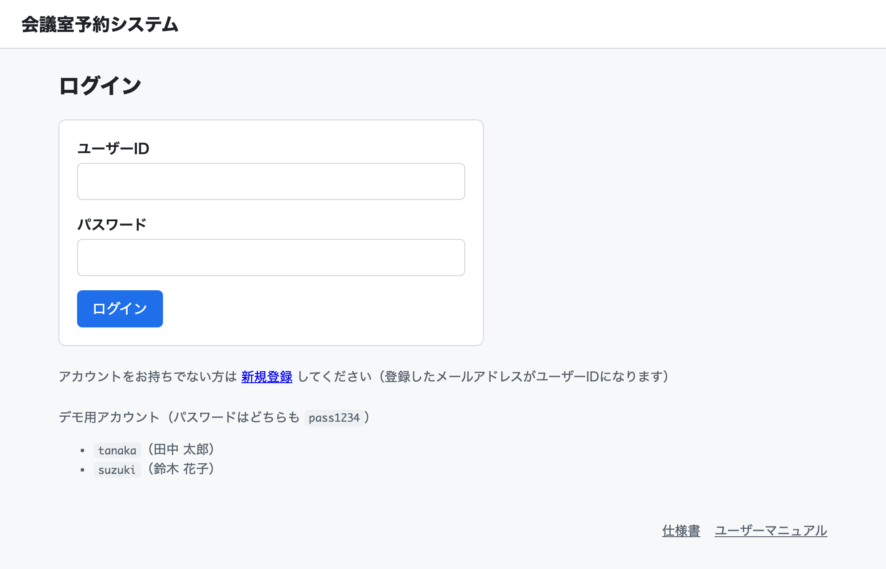
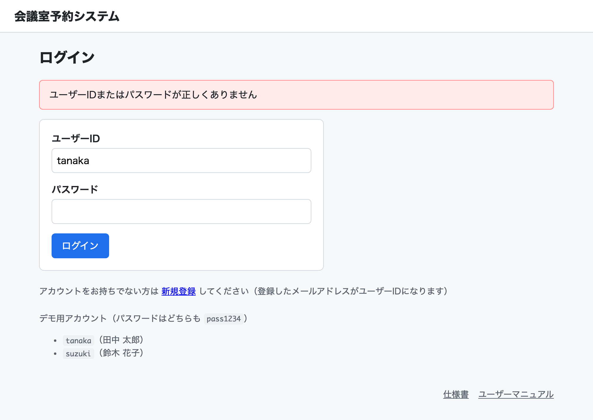
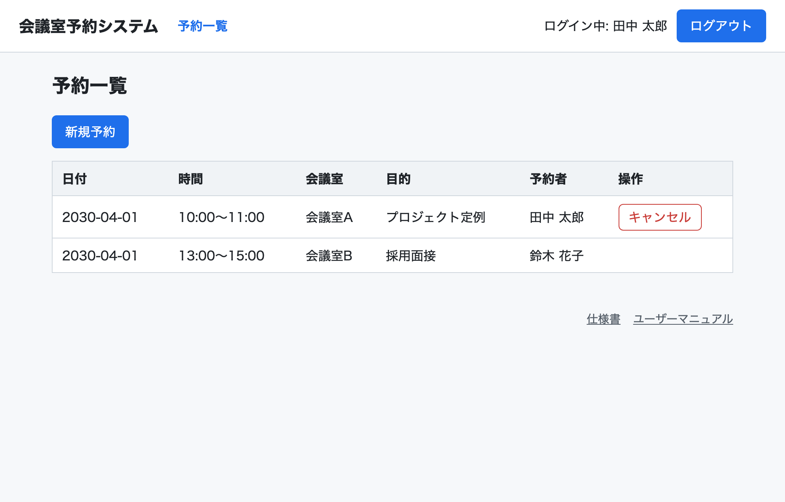
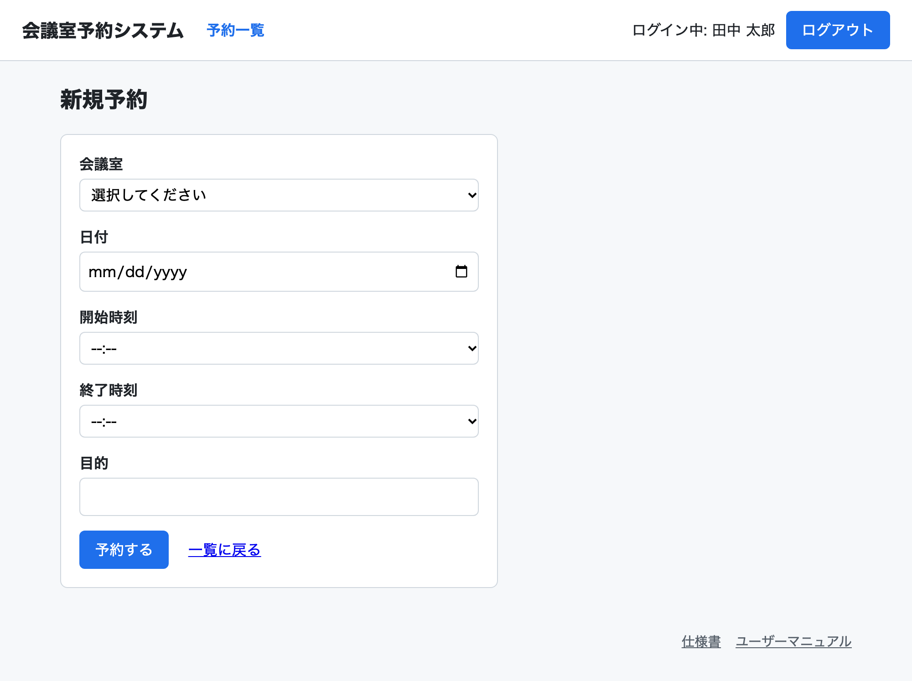
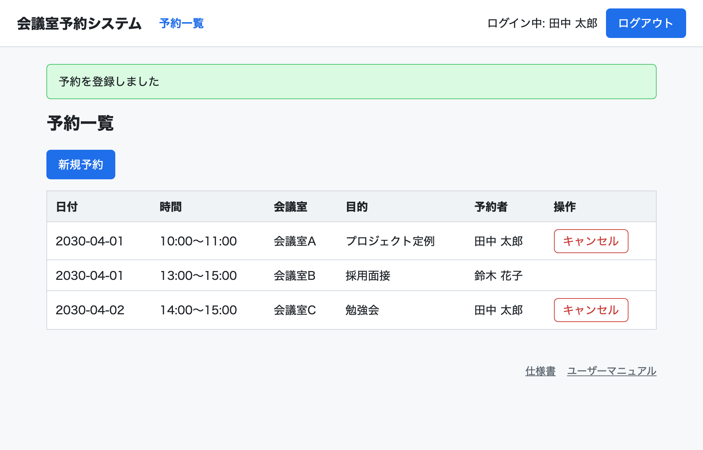
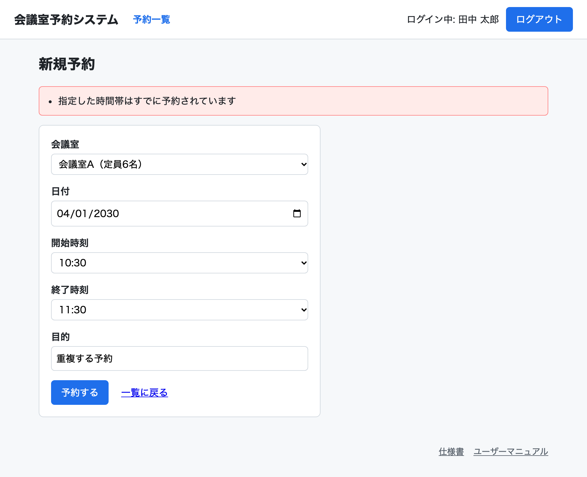

# 会議室予約システム ユーザーマニュアル

## 1. アプリケーションを開く

講座ではデモ環境を使います。配布された URL をブラウザで開いてください。

自分の PC で動かす場合は、ターミナルでこのフォルダに移動して `npm start` を実行し、「会議室予約システムを起動しました: http://localhost:3000」と表示されたら <http://localhost:3000> を開きます。終了するときは `Ctrl + C` を押します。

## 2. ログイン

1. ユーザーIDとパスワードを入力し、「ログイン」ボタンを押します
2. ログインに成功すると予約一覧画面が表示されます

利用できるアカウントは画面下部に表示されています。

| ユーザーID | パスワード |
| --- | --- |
| tanaka | pass1234 |
| suzuki | pass1234 |

ユーザーIDまたはパスワードが間違っていると、エラーメッセージが表示されます。

## 3. 予約を確認する

ログインすると、全員の予約が日付順に一覧表示されます。
自分の予約には「キャンセル」ボタンが表示されます。

## 4. 予約を登録する

1. 予約一覧画面の「新規予約」ボタンを押します
2. 会議室・日付・開始時刻・終了時刻・目的を入力し、「予約する」ボタンを押します

登録が完了すると、予約一覧画面に「予約を登録しました」と表示され、一覧に追加されます。

入力内容に問題がある場合はエラーメッセージが表示されます。たとえば、すでに予約がある時間帯を指定した場合は次のように表示されます。

## 5. 予約をキャンセルする

予約一覧画面で、自分の予約の行にある「キャンセル」ボタンを押します。
確認ダイアログは表示されず、すぐにキャンセルされます。

## 6. ログアウト

ヘッダーの「ログアウト」ボタンを押すとログアウトし、ログイン画面に戻ります。

## 7. API で操作する

画面を使わずに予約を登録・削除したい場合は、JSON API が使えます。使い方は[仕様書の 7 章](spec.md#7-api)を参照してください。
